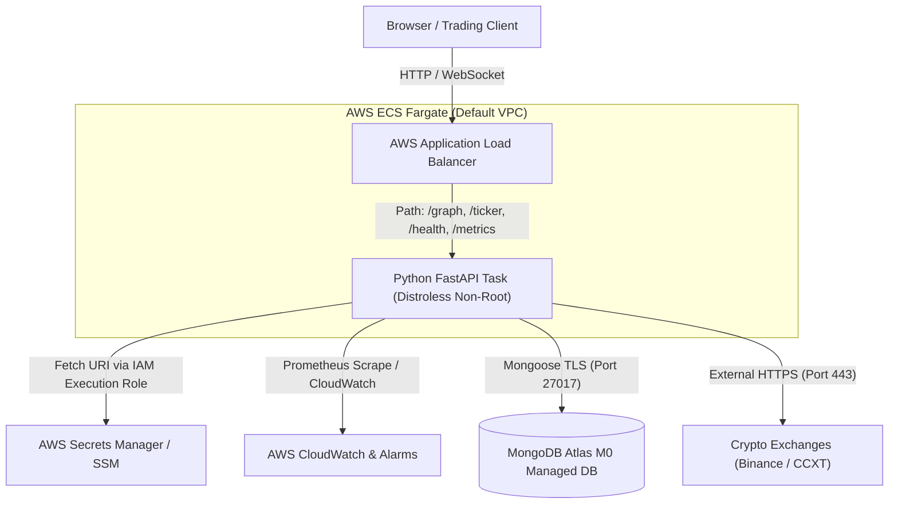

# Craon DevOps Take-Home Assignment

Ship a containerized full-stack Python application to AWS ECS (Fargate) with Terraform, automated GitHub Actions DevSecOps (OIDC), Prometheus observability, and SRE incident response.

---

## Open Source Attribution

* **Base Repository**: [BiswajitRB/Python-Based-MCP-Server-for-Crypto-Market-Data](https://github.com/BiswajitRB/Python-Based-MCP-Server-for-Crypto-Market-Data.git)
* **License**: MIT License (see [LICENSE](file:///d:/homeassigement/LICENSE))
* **DevOps Additions**:
  * Integrated MongoDB persistence layer (`app/services/db_service.py`) for ticker snapshots and watchlists.
  * Added Prometheus `/metrics` exposition and structured JSON access logging with UUID `request_id`.
  * Multi-stage Google Distroless Python Dockerfile (`gcr.io/distroless/python3-debian12:nonroot`).
  * Full AWS Terraform IaC (ECS Fargate, ALB, MongoDB Atlas M0, CloudWatch Alarms).
  * Staged DevSecOps CI/CD pipeline (Gitleaks, Hadolint, SonarQube, Trivy, and OIDC deployment).

---

## Architecture Overview



---

## 1. Quick Start: Run Locally with One Command

Prerequisites: [Docker Desktop](https://www.docker.com/) installed.

```bash
docker compose up --build
```

Access the local services:
* **Interactive Graph UI**: [http://localhost:8000/graph](http://localhost:8000/graph)
* **Backend API Root**: [http://localhost:8000](http://localhost:8000)
* **Live Ticker**: [http://localhost:8000/ticker?symbol=BTC/USDT](http://localhost:8000/ticker?symbol=BTC/USDT)
* **Health Check**: [http://localhost:8000/health](http://localhost:8000/health)
* **Prometheus Metrics**: [http://localhost:8000/metrics](http://localhost:8000/metrics)
* **Simulated Incident Drill**: [http://localhost:8000/simulate-500](http://localhost:8000/simulate-500)

To stop containers and clean volumes:
```bash
docker compose down -v
```

---

## 2. Infrastructure as Code (Terraform)

All AWS infrastructure and MongoDB Atlas resources are declared in [`terraform/`](file:///d:/homeassigement/terraform/).

```bash
cd terraform
terraform init
terraform plan
terraform apply
```

To tear down all resources cleanly:
```bash
terraform destroy -auto-approve
```

---

## 3. Staged DevSecOps Pipeline (GitHub Actions)

* **Pipeline File**: [.github/workflows/ci.yml](file:///d:/homeassigement/.github/workflows/ci.yml)
* **Stage 1 (Parallel < 30s)**: Secret detection (Gitleaks) + Dockerfile linting (Hadolint).
* **Stage 2**: Unit tests & SonarQube SAST analysis (`needs: [secret-scan, dockerfile-lint]`).
* **Stage 3**: Build Distroless Python image & Trivy container CVE scan (`needs: [test-and-sonar]`).
* **Stage 4**: Deploy to Staging environment & automated `/health` smoke test.
* **Stage 5**: Production deployment gate with approval.

---

## 4. Deliverables Index
* **Answers & Technical Decisions**: [ANSWERS.md](file:///d:/homeassigement/ANSWERS.md)
* **Log Triage Shell Script**: [scripts/triage.sh](file:///d:/homeassigement/scripts/triage.sh)
* **Sample Access Log**: [sample/access.log](file:///d:/homeassigement/sample/access.log)
* **Terraform Plan Output**: [terraform/terraform_plan_output.txt](file:///d:/homeassigement/terraform/terraform_plan_output.txt)
* **On-Call Runbook & Incident Postmortem**: [RUNBOOK.md](file:///d:/homeassigement/RUNBOOK.md)
* **Pull Request Description**: [PULL_REQUEST.md](file:///d:/homeassigement/PULL_REQUEST.md)
